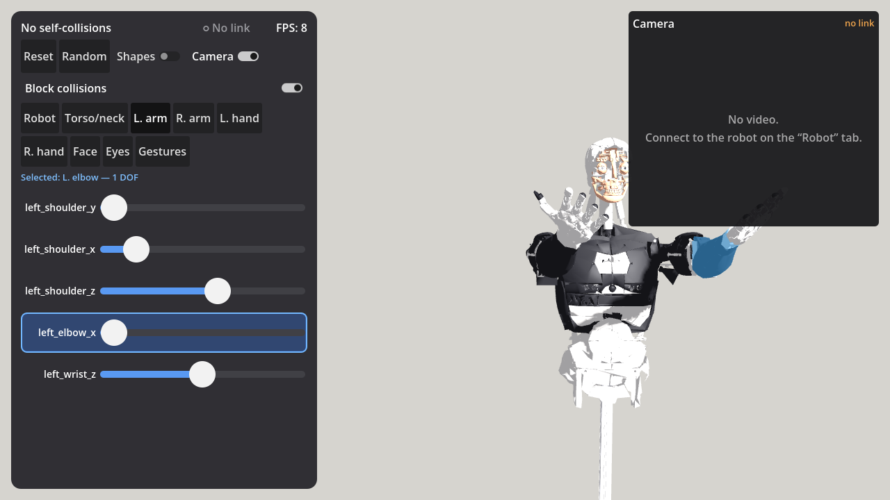

# InMoov i2 Viewer

_Author: Artur-Fedjukevits_

A Godot 4 app (desktop + Android) that draws the **InMoov i2** humanoid robot in 3D from its URDF and lets you
pose it, check self-collisions, record gestures, and — optionally — mirror or control a real robot over
[rosbridge](https://github.com/RobotWebTools/rosbridge_suite).



## Features

- **3D model** loaded from a lightweight `inmoov.glb` (150k triangles) plus `inmoov_robot.json` (joint axes, limits,
  mimic joints, collision shapes, SRDF-disabled collision pairs). Forward kinematics in Godot matches the URDF.
- **41 controllable joints** on tabs (Torso/neck, arms, hands, Face, Eyes) with large touch-friendly sliders.
- **Click / tap a body part** to open its tab and highlight all of its sliders (shoulder = 3 DOF, neck = 3, eye = 2 …).
- **Self-collision checking** with one `Area3D` per link; colliding links turn red, and "Block collisions" rolls a
  move back to the last valid pose.
- **Gestures**: save the current body or face pose as JSON, apply it, copy it, or publish it to the robot
  (see [GESTURES.md](GESTURES.md)).
- **Robot link** (rosbridge): *Mirror* (model follows the real robot), *Control* (sliders drive the robot) and
  *Calibration* (fit the servo↔URDF table).
- **Camera window**: live video from the robot's OAK-D Lite over a WebSocket (JPEG/PNG/WebP frames).
- Orbit camera with mouse and multi-touch (1 finger rotate, 2 fingers pinch/pan).

## Project layout

| Path | What it is |
|---|---|
| `robot/inmoov.glb`, `robot/inmoov_robot.json` | Robot model and kinematics/collision data (generated from the URDF, see below) |
| `scripts/inmoov_robot.gd` | `InmoovRobot`: `set_joint()`, `set_pose()`, `get_pose()`, `check_pose()`, collisions, picking |
| `scripts/main.gd` | UI: panel, tabs, sliders, click-to-pick, gestures, calibration page |
| `scripts/orbit_camera.gd` | Mouse + touch orbit camera |
| `scripts/rosbridge_client.gd` | Minimal rosbridge v2 client (WebSocket + JSON, auto-reconnect) |
| `scripts/robot_link.gd` | `RobotLink`: Mirror / Control / Calibration modes on top of rosbridge |
| `scripts/camera_view.gd` | `CameraView`: robot camera video window |
| `tests/` | Headless tests, UI tests, screenshot helpers and mock servers |

## Run

1. Install **Godot 4.7** (the project uses the *Mobile* renderer).
2. Open Godot → *Import* → select `project.godot` → press **F5**.
3. Tests:
   ```
   godot --headless --path . -s res://tests/run_tests.gd
   xvfb-run godot --rendering-method gl_compatibility --path . -s res://tests/ui_test.gd
   ```

The app works stand-alone as a posable viewer; no robot is required.

## Connecting to a robot

The app expects this on the robot side (not included in this repository):

- `rosbridge_websocket` on port 9090;
- a `urdf_bridge` node that converts between servo degrees and URDF radians using a `servo_urdf_map.yaml` table
  and provides `/urdf_joint_states`, `/urdf_joint_cmd` and the calibration services;
- optionally a WebSocket video server on port 9091 (640×480, ~15 fps, one binary JPEG per message).

In the app: **Robot** tab → enter the robot's IP → **Connect**. All angles on the wire are URDF radians.

To try it without a robot, `tests/mock_camera_ws.py` serves a fake video stream
(`pip install websockets pillow`, then enter your PC's IP in the app). `tests/link_test.gd` is an end-to-end test
against a mock rosbridge robot that you need to provide.

## Updating the robot model

`robot/inmoov.glb` and `robot/inmoov_robot.json` are generated from the robot's URDF/SRDF
(Blender → LinkForge export, then a mesh-decimation script). That pipeline lives outside this repository;
the generated files are committed so the app runs out of the box. Rules the app relies on:

- Angles are radians in the URDF convention (0 = the Blender rest pose).
- Mimic joints (finger Mid/Tip) follow their leader and are never driven directly.
- glb hierarchy: `inmoov_root` (Z-up → Y-up) → link node → joint node (fixed origin) → child-link node
  (the app writes `Basis(axis, angle)` here) → meshes `<link>__<color>`.
- Collision results are available after a physics step (~16–33 ms).

## Android

1. *Editor Settings → Export → Android*: set the JDK 17 and Android SDK paths; *Manage Export Templates → Download*.
2. *Project → Export → Add… → Android*, set your own package name and keystore, then export an APK.
3. `export_presets.cfg` must keep `permissions/internet=true`, otherwise the phone has no network.

Troubleshooting:

- **Touches do nothing and orange frames appear on tap** — the editor's *Game* tab is in *Select* mode.
  Switch it to *Input* when running through Remote Deploy / Remote Debug.
- `Could not start scrcpy executable` on Remote Deploy is harmless (scrcpy screen mirroring is not installed).
- `WebSocketPeer.inbound_buffer_size` defaults to 64 KB, which is too small for video frames; `CameraView` uses 4 MB.

## License

- **Code** (`scripts/`, `tests/`, project files): [GNU GPL v3.0 or later](LICENSE), © 2026 Artur-Fedjukevits.
- **Robot model** (`robot/`): derived from the open-source [InMoov](https://inmoov.fr) design by Gaël Langevin,
  licensed under **CC BY-NC 4.0** (attribution, non-commercial). These files keep that license.
